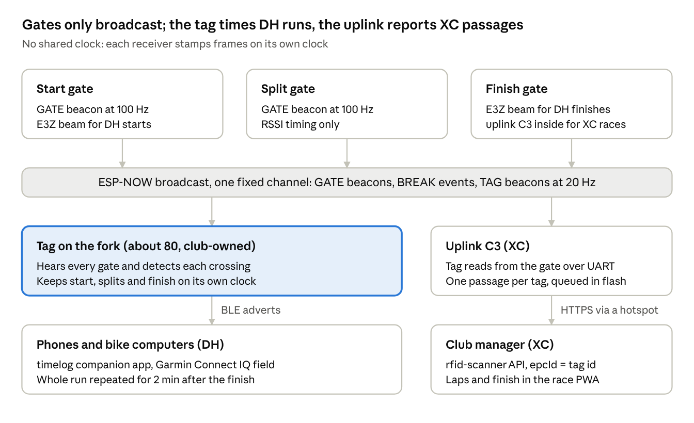

# ESP32 race timing for XC and DH

As of 12 Nov 2026.

## Purpose and scope

This repository hands over a club timing system built from cheap ESP32-C3 boards: trackside **gates** and a **tag** on each bike, with an optional Omron light barrier for DH. The design is written up, the core timing logic is implemented and host-tested, and the radio works on the desk; no field test has run yet (11 of 39 tasks done).

- **XC races:** order and approximate time of each rider, laps and finish, fed into the club manager's existing race timing module.
- **DH runs (training and club races):** run and split times per rider, delivered to phones over BLE, with the light barrier at start and finish for precise times.
- **Not included:** anything about suspension or ride telemetry, the data logger it was designed next to, and that project's firmware.

## How it fits together

Gates are dumb broadcasters: no clock, no state, no per-rider setup. The intelligence sits in the receivers, the tag for DH and the uplink for XC.



DH times flow tag → phone over BLE with no network; XC passages flow tag beacon → finish gate → uplink → club manager. One firmware image runs on every unit, and a stored setting picks its role.

## XC timing: RSSI crossings, no barrier

XC is timed purely from radio signal strength: the uplink in a gate watches each tag's beacon RSSI rise and fall and reports one passage per pass. A barrier can't tell riders apart in a group, so XC uses none.

**Crossing detector** (the same code runs on the tag per gate and on the uplink per tag):

1. Bin RSSI (50 ms on the tag, about 5 gate beacons per bin; 100 ms on the uplink, about 2 tag beacons per bin), mean dBm per bin.
2. Smooth with a 250 ms moving average.
3. Candidate = highest smoothed bin above the threshold (default −80 dBm).
4. Confirm when the signal stays ≥ 6 dB below the candidate for 200 ms, or no frame arrives for 300 ms. Confirming on the falling edge, not the window maximum, is what makes the finish area work.
5. Time = vertex of a least-squares parabola through the raw bins within 4 dB of the top (at least the two neighbours, at most 3 s each side).
6. Hold that gate for the minimum interval (default 10 s) and until the signal has once dropped below the threshold, so a rider standing at the finish never gives a second passage.

**Why the wide fit:** the radio reports whole dB, so a peak's top is flat (0.5 m from the gate, 2 m off the line, the signal is only 0.3 dB weaker) while readings jitter about ±2 dB. A 3-point parabola erred by up to 228 ms at 15 km/h in simulation.

**Simulated accuracy** (noise only, 50 passes each, gate 2 m off the line):

| Speed | Worst error |
| --- | --- |
| 50 km/h | 20 ms |
| 30 km/h | 30 ms |
| 15 km/h | 46 ms |
| 10 km/h | 47 ms |
| 5 km/h | 90 ms (51 ms with the gate 1 m off) |

- **Body shadow** pulls the fitted peak forward by roughly 0.4 m (model). Constant per gate, it cancels in lap times; its variation grows as riders slow, so place uphill split gates ≤ 1 m from the line.
- **Confirmation delay:** under 1 s at ≥ 25 km/h, about 1.1 s at 15 km/h, 2.6 s at 5 km/h.
- **Prior art:** a commercial Wi-Fi RSSI system sampling at 20 Hz reaches about ±0.1 s for a sharp gate; ESP-NOW at 100 Hz avoids most of its error sources.

**Club manager integration.** The uplink speaks the club manager's existing RFID reader API, with `epcId` = tag id:

- `GET /api/rfid-scanner/config` every 1 s (OFF / CONTINUOUS / LIST)
- `POST /api/rfid-scanner/continuous`: tags heard at ≥ −50 dBm, so the PWA's existing scan flow pairs a tag to a starting number
- `POST /api/rfid-scanner/passages` (`epcId`, `observationTime`, `readerId`) every 500 ms, at most one passage per tag per batch, and ≥ 2 s apart per tag when flushing a backlog

Found in the server code: it keeps only the first passage per tag in a batch, ignores `readerId` (so every passage becomes a lap; splits need a server change), uses a 10 s minimum lap, and the scanner endpoints appear to need no login. Laps and finish need no server change.

**Offline queue:** passages go to an append-only log in a 64 kB flash partition (CRC per record, ack counts, compaction per 4 kB sector), holding 3800+ unsent passages through a hotspot outage or a power cycle.

**Air budget:** start groups of at most 40 (then 20 + 20); the start isn't timed. The hard case is the finish area with 60–80 parked tags within 50 m: 80 tags at 20 Hz is about 19 % air time, beyond the 30-bike design assumption, and still to be tested.

## DH timing: light barrier at start and finish, tag keeps the clock

In DH the tag times its own run: it detects each gate, keeps start, splits and finish on its own clock (start = 0), and broadcasts the results over BLE. No gate needs a clock, an uplink or per-rider setup.

**Light barrier.** An Omron E3Z-R61 (retro-reflective, NPN, 12–24 V, 1 ms response, reflector ≤ 4 m) in L-ON mode: a blocked beam drives the GPIO high.

- Wiring: 12 V from a 5→12 V boost; output through 1 kΩ to GPIO3 with a 10 kΩ pull-up to 3.3 V; shared ground. Avoid the C3's strapping pins.
- The gate stamps the rising edge in an ISR (µs resolution), then locks out 1.5 s.
- It sends a BREAK frame 5 times within 50 ms. Each copy carries `age_us` (send time − break time) and the strongest tag heard in the last second, so the tag computes `break = rx − age` on its own clock. No shared clock needed.
- A beam blocked for 10 s raises a fault flag in the gate beacon (unplugged, unpowered or blocked).
- The sensor plugs in via M8 4-pin; the spare pin is a presence sense that switches on the boost and sets the beacon's barrier flag. Without the plug the gate is an RSSI gate, so every setup also works without a barrier.

**Beam and RSSI together.** The tag takes a BREAK that names it, or names no tag while its own RSSI to that gate is above threshold within 1.5 s. A beam time replaces an RSSI crossing of the same gate within 1.5 s (event re-sent with a beam flag). At a start gate with a working barrier the tag never uses RSSI, so a rider waiting in the start hut can't start the clock. A standstill start needs the beam; without it riders roll through the start gate.

**Run events over BLE.** Legacy advertising (manufacturer data, 24-byte payload), because Garmin Connect IQ and older phones don't reliably receive extended adverts. iOS hides the MAC, so the tag id is in the payload.

| Bytes | Field |
| --- | --- |
| 0 | version (high nibble) · run state idle / running / finished |
| 1–4 | tag id |
| 5 | run counter |
| 6 | event count n |
| 7–9 | run clock, ms since start (u24, 4.6 h) |
| 10 | battery % |
| 11 | number k of event A |
| 12–17 | event A: gate id · kind (start, split, lap, finish; beam bit) · index · ms since start (u24) |
| 18–23 | event B = event k−1 |

- Each advert repeats two events plus the run clock, so a listener survives lost adverts and converts to wall time as `rx − (run clock − event time)`.
- Rates: the latest pair at 10 Hz for 5 s after each event, then 1 Hz.
- After a finish the tag cycles all events (pages k = n, n−2, …) every 500 ms for 2 min: a 5-event run needs 3 pages, so a timekeeper at the finish gets the whole run, including splits out of earshot, within 1.5 s.
- Run identity = tag id + run counter, so a timekeeper's phone and the rider's own phone can deduplicate.
- Listeners: the timelog companion app (beside its existing Freelap reader, posting into group or individual activities) and a possible Garmin Connect IQ field. Web Bluetooth can't scan adverts on iOS, so the club manager PWA gets data from the server instead.

**Accuracy targets** (to be verified): beam-timed crossings within ±5 ms of 240 fps video, RSSI crossings within ±0.1 s, break time on the tag within 3 ms.

## Hardware: 5 identical gates, about 80 club-owned tags, one charging rack

The direction was agreed in early November 2026; nothing beyond desk prototypes is built. Items marked *suggested* were proposed but not decided.

| Unit | Decided | Suggested / open |
| --- | --- | --- |
| Gate (×5, same for DH and XC) | XIAO build: 2× XIAO ESP32-C3 (timing + built-in uplink, joined by UART, uplink sleeps without a hotspot); E3Z-R61 via M8 4-pin with presence sense; the 2 barriers on hand move between DH start and finish; XIAO FPC antenna inside the box on the trail-facing wall, ≥ 15 mm from the cell | One 21700 cell (~5 Ah, protected) with a power-path charger (e.g. BQ24074, USB-C) for one race day; box with M8 on one end wall, USB-C on the other, BOOT + LED on the roof, 1/4" tripod nut in the floor; a directional 2.4 GHz patch (Taoglas WPC.25A or a Moxon) as an option; a JLC gate board only later |
| Tag (~80) | Club-owned, Velcro strap on the fork like Freelap chips; each tag bound once to a starting number in the club manager (no race-day pairing) | ESP32-C3-MINI-1 on a JLC board, sealed, pogo charging, OTA updates, magnet or motion wake; antenna ≥ 5–10 mm from the fork leg |
| Charging rack | Power plus a dock C3; Gridfinity bins printed on a Bambu P1S, stacked into one tower; modules of 20 keyed vertical slots (5×2 bin) with pogo pins (5 V, GND) and a PTC per slot; magnetic pogo connectors between modules, live only when mated; a base module with USB-C PD (20 V bus, one 100 W charger) and the dock C3; slot number = tag number = plate number; lifting a tag switches it on; tags blink their LED for "find tag n" | Temperature cutoff per module |

- **Firmware updates:** upload from a phone to the dock's setup page; the dock checks the signature, installs it on itself (rollback possible), then serves its running image to docked tags and gates over ESP-NOW. Gate, tag, uplink and dock are one binary.
- **Compliance (decided: pragmatic route):** certified modules with their tested antennas, TX within EN 300 328, a simple club declaration of conformity. Suggested consequences: tags ≤ 10 dBm EIRP; a gate with a directional antenna capped at 20 dBm EIRP; protected cells charging only at 0–45 °C via NTC; no unattended overnight charging.
- **Power banks** were the first plan for gates but switch off below ~50–100 mA, hence the built-in cell suggestion.

**Prototype path (agreed):**

1. P0 desk: 2 XIAO C3 + E3Z.
2. P1 RF at the fork: ESP32-C3-DevKitM-1 (same PCB antenna as the MINI-1) in printed fork cases, with video.
3. P2 battery: XIAO + 400 mAh LiPo, measured with a power meter or PPK2.
4. P3 air load: firmware emulation, each board sending beacons for many virtual tag ids (no batch of dev boards ordered).
5. P4: 5–10 sealed v0 tags (XIAO + LiPo, printed case) and one Gridfinity tag module.
6. P5: a small JLC run of tag, rack and gate boards.
7. P6: the batch of 80.

## Firmware: one ESP-IDF app, timing logic host-tested

One ESP-IDF 5.4 app for the ESP32-C3 holds every role; a stored setting makes a board a gate, a tag or an uplink. All timing logic sits in a platform-free C component, tested on a PC with Unity against synthetic RSSI traces.

| Role | Radio | Does |
| --- | --- | --- |
| gate | ESP-NOW | GATE beacon at 100 Hz; hears tags; BREAK events with a barrier; read stream to the uplink over UART |
| tag | ESP-NOW + BLE | TAG beacon at 20 Hz; crossing detection; run timing; BLE adverts |
| uplink | Wi-Fi station | reads the gate's stream, detects passages, posts to the club manager |

- **Fixed channel:** all timing traffic is ESP-NOW broadcast on one fixed Wi-Fi channel. A board that hears the gates must never join a Wi-Fi network (that moves its channel), which is why the uplink is a second C3.
- **6 Mbps PHY:** at the default 1 Mbps a ~70-byte frame takes ~0.75 ms, so 30 bikes at 20 Hz would use 45 % of the air. At 6 Mbps OFDM (~0.12 ms per frame) that drops to 7 %, plus 3.6 % for 3 gates at 100 Hz, at a cost of ~8 dB sensitivity. Fallback: 1 Mbps with tags at 10 Hz.
- **Frames:** a 12-byte header (magic, version, kind, flags, unit id u32, sequence u32), then GATE (role, index, flags for barrier / fault / unconfigured, battery; 16 B), TAG (state, battery; 16 B) and BREAK (seq, copy, flags, age µs, nearest tag; 24 B). Little-endian.
- **Tag id:** the low 4 bytes of the Wi-Fi MAC as 8 hex digits, printed on the label and used everywhere (frames, adverts, club manager `epcId`, timelog chip id).
- **Gate → uplink stream:** NMEA-style lines at 921 600 Bd, `$TGR,<tag>,<rssi>,<us>*hh` per tag frame and `$TGS,<gate>,<role>,<us>,<drops>*hh` each second. The uplink maps the gate's clock to its own with a lower-envelope offset over 10 s, then SNTP gives wall time. Raw reads let any host (a laptop, a Pi) run its own detector.
- **Settings:** USB console commands (`role`, `gate <id> start|split <n>|finish|startfinish`, `barrier`, `stream`, `thresh`, `minint`, `wifi`, `server`, `reader`, `token`, `show`), stored in NVS. Planned: a setup Wi-Fi AP with captive portal, entered by a 3 s BOOT press, with a password set on first use.

| Part | State |
| --- | --- |
| Frame, advert and stream codecs | Done, host-tested |
| Crossing detector | Done, host-tested (50 seeds per speed, standing rider, approach fade) |
| Run state machine (DH, XC laps, restarts, 30 min abandon, start hut wait) | Done, host-tested |
| BREAK handling on the tag | Done, host-tested |
| Passage queue log | Done, host-tested |
| App scaffold, console, NVS settings | Done, on hardware |
| Gate and tag beacons, `trace` capture | Done, on hardware |
| BLE adverts and summary pages | In progress |
| Barrier ISR on the gate, read stream, uplink role, setup AP | Not started |

## Measured so far: desk only

The only hardware measurement is a desk test on 5 Nov 2026: two XIAO ESP32-C3 about 20 cm apart, one as a gate and one as a tag, both at 6 Mbps.

| | Tag hears the gate | Gate hears the tag |
| --- | --- | --- |
| Sent | 100.0 Hz | 20.0 Hz |
| Received per second (60 s) | 97–100, mean 99.75 | 17–20, mean 19.68 |
| Lost | 0.25 % | 1.6 % |
| RSSI | −20 dBm | −20 dBm |

- The gate's higher loss is likely its own 100 Hz sending: a C3 can't receive while it transmits.
- After a gate reset its beacons were back at the tag within about 0.3 s.
- A 60 s RSSI trace held 5986 frames with none dropped: median interval 9995 µs, standard deviation 0.8 ms, longest gap 32 ms.

The bench capture scripts (an RSSI trace recorder and a range/loss logger) are not part of this repository; the tag's `trace`, `xings` and `xdump` console commands give the same data over USB.

## Open questions and next steps

The biggest unknowns are real-world RSSI behaviour at a gate and the crowded XC finish area; both need field traces before more hardware is built.

**Risks and open questions**

- Finish area with 60–80 tags (~19 % air time at 20 Hz): loss, and whether the detector still gives one passage per rider.
- Real body shadow and multipath: may favour fitting the approach side of the peak; the default thresholds (−80 dBm crossing, −50 dBm pairing, 10 s minimum interval) need tuning from traces.
- 6 Mbps loss at the edge of range (target < 5 % at 30 m).
- BLE advertising on the tag costs gate beacons (target < 10 percentage points more loss).
- Club manager: the scanner API appears open to anyone; splits need `readerId` mapped to a role; batch and aggregation behaviour must be checked before the first race.
- Whether a directional antenna helps split gates.

**Next steps, in order**

- [ ] Range and PHY-rate test at 1 m and 30 m, 6 and 1 Mbps, 10 min each
- [ ] First passes with the tag on a fork: 10 rides at ≥ 25 km/h, 5 walks with the gate 1 m off the line; add 3 captures as test vectors
- [ ] Barrier gate build, ISR and BREAK sending; 200-break latency loop-back on the desk
- [ ] Finish BLE adverts and the run summary; a reference listener in Python (bleak)
- [ ] Field test at 30 km/h against 240 fps video
- [ ] Read-stream and uplink role; test against a local club manager, including a 5 min hotspot outage
- [ ] XC finish-area test (riders stopping near the gate for 2 min) and a DH test (5 runs, timekeeper at the finish only)
- [ ] Battery and fork-mount prototypes (P1, P2), then sealed v0 tags and one rack module (P4)
- [ ] Other repositories: a timing-gates adapter in the timelog companion app; a split role per `readerId` and a reader token in the club manager

## Code in this repository

- `components/tlog_timing/`: platform-free C (no ESP-IDF includes). Frame header and bodies, BLE advert and read-stream codecs, crossing detector, run state machine, BREAK handling, advert pages, the uplink's passage queue.
- `app/`: the ESP-IDF 5.4 app for the ESP32-C3. One binary; the role (gate, tag, uplink) is a stored setting. The uplink role currently only logs a message.
- `test/`: Unity host tests for the component (Unity is fetched by CMake).

Comments in the code cite design decisions (D1–D12), task numbers and spec scenarios from the original design notes; the sections above cover the same content.

```sh
./test/run.sh                                   # host tests (6 suites)
cd app && idf.py set-target esp32c3 && idf.py build flash monitor
```

On the USB console, `help` lists the commands. To try it on two boards: `role gate`, then `gate 1 startfinish` on one; `role tag` on the other; `hear on` on either shows what it receives, and `break` on the gate sends a test BREAK.
